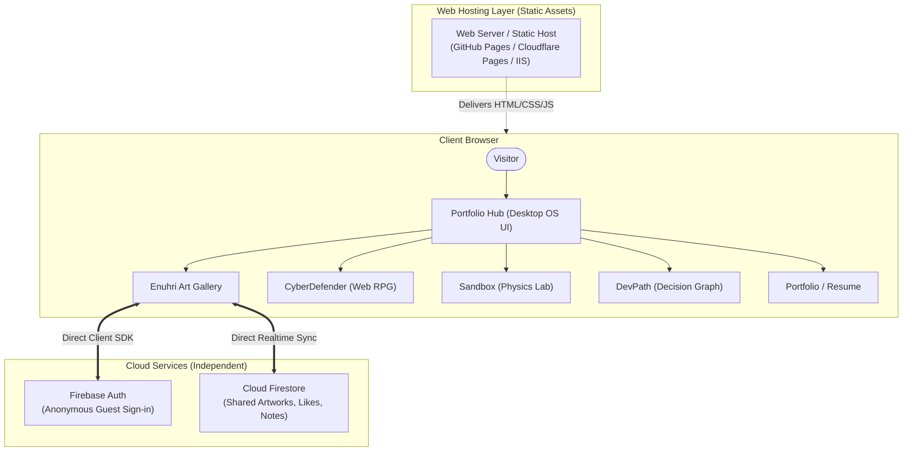
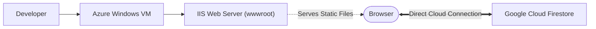

# Portfolio Hub (`enuhri-hub`)

> **Interactive Retro-Desktop Environment, Simulation Lab & Multi-Project Portfolio System**  
> Developed by **Jendrick / Enuhri** — BSIT (Software Engineering) Student at *Universidad de Manila*.

---

## Overview

**Portfolio Hub** is an interactive, browser-based personal portfolio and application launcher designed as a retro desktop workstation. Rather than presenting a conventional static resume webpage, the hub models a vintage CRT terminal environment featuring boot sequences, ambient scanline aesthetics, window management, project dossiers, and self-contained interactive web applications.

This repository serves as the central public codebase for the hub, containing the desktop environment, standalone simulation engines, playable games, and architectural case studies.

> [!NOTE]  
> **Development Context**: This project represents an ongoing student engineering portfolio. It has been developed through rapid iterative prototyping, experimental systems design, and extensive AI-assisted development across frontend engines, cellular automata, and interactive media.

---

## System Architecture

The Portfolio Hub separates static presentation from cloud state, ensuring that the frontend remains lightweight, resilient, and completely independent of any single hosting provider.

### Architecture Diagram



### Architectural Separation: Frontend vs. Hosting vs. Cloud

1. **Frontend Hub & Applications**: 100% static client-side web technologies (HTML5 Canvas, Vanilla ES Modules, SVG vector rendering, Web Audio API, modern CSS). There is no server-side Node.js, Python, or PHP process required to serve the core hub.
2. **Web Hosting Layer**: The web server simply delivers static files (HTML, CSS, JS, audio, images) to the user's browser.
3. **Cloud Data Layer (Firebase / Firestore)**: Used exclusively by the **Enuhri Art Gallery**. The visitor's browser connects directly to Google Cloud Firestore via the official Firebase Web SDK. **Firebase does not route through or depend on the web hosting server.**

---

## Hosting History & Current Status



### Historical Development: Azure VM + Windows IIS
The Portfolio Hub was originally developed, staged, and hosted within a **Microsoft Azure Windows Virtual Machine** running **Internet Information Services (IIS)** at `c:\inetpub\wwwroot\enuhri-hub`. IIS was configured to serve static assets, handle MIME types (`.svg`, `.json`, `.ogg`), and disable development caching via `web.config`.

### Current Hosting Status & Azure Credit Depletion
* The Azure VM was funded through a **Microsoft Azure Student Subscription**.
* Because the allocated student credits are nearly exhausted (< $20 remaining), the Azure VM is frequently deallocated and is **not maintained as a permanent production host**.
* **Critical Technical Distinction**: **An offline Azure VM does NOT mean Firestore or the Art Gallery backend stops working.** Because the Art Gallery connects directly from the visitor's browser to Google's cloud infrastructure, the community art, likes, and comment synchronization remain fully operational. The only limitation of an offline VM is that the static files cannot be fetched from that specific IP address.

### Migration Readiness for Free Static Hosting
Because the entire repository consists of static frontend code with relative asset paths, it is 100% compatible with modern static hosting providers:
* **GitHub Pages** (native repository hosting)
* **Cloudflare Pages** (edge CDN delivery)
* **Firebase Hosting** (direct pairing with the existing `enuhri-hub` Firebase project)
* **Netlify / Vercel**

---

## Applications & Projects Inside the Hub

```text
┌────────────────────────────────────────────────────────┐
│ [1] Portfolio / Resume      [2] Enuhri Art Gallery     │
│ [3] CyberDefender           [4] Sandbox Simulation     │
│ [5] DevPath (Graph Engine)  [6] UDM Radar (Case Study) │
│ [7] StudyQuest (Case Study) [8] App 06 (System Slot)   │
└────────────────────────────────────────────────────────┘
```

### 1. Portfolio / Resume (`portfolio/`)
* **Status**: Live / Integrated.
* **Overview**: An interactive personal dossier and technical profile styled like a retro OS window.
* **Features**:
  * Technical skill matrix across Frontend, Systems, and Development Tools.
  * BSIT academic background at Universidad de Manila.
  * Project showcases with modal architecture reviews and credential downloads.
* **Tech Stack**: HTML5, CSS3, Vanilla JavaScript.

---

### 2. Enuhri Art Gallery (`art-gallery/`)
* **Status**: Live / Integrated with Cloud Backend.
* **Overview**: A 2.5D neoclassical art museum and collaborative community exhibition hall.
* **Key Features**:
  * **Entrance Hall & Gallery Hall**: Smooth horizontal exploration using mouse drag, touch swipe, or arrow keys with multi-layer CSS parallax depth.
  * **Artist Studio**: In-browser drawing canvas with custom color palettes, brush sizes, and image upload capabilities.
  * **Cloud Persistence (Firebase Firestore)**: Real-time community artwork synchronization (`artworks` collection). Visitors can submit creations directly to the gallery wall.
  * **Social Interactions**: Real-time artwork likes and visitor guestbook notes powered by Firestore `onSnapshot` listeners.
  * **Anonymous Authentication**: Seamless guest sign-in (`signInAnonymously`) requiring no registration friction.
  * **Graceful Offline Fallback**: If Firestore is blocked or unreachable, the gallery automatically catches the network error and falls back to rendering built-in procedural artworks.
* **Tech Stack**: HTML5 Canvas, CSS3 Parallax, Vanilla ES Modules, Google Firebase Web SDK v12.19.0 (Auth + Firestore).

---

### 3. CyberDefender (`cyberdefender/`)
* **Status**: Live / Integrated Playable Game.
* **Overview**: A native HTML/web tactical RPG adventure rebuilt and reimagined from an original mobile prototype created in Godot 4.
* **Key Features**:
  * **Godot-to-Web Reimagining**: Redesigned from the ground up for the browser, eliminating engine runtime overhead while preserving the core tactical mechanics.
  * **Tactical Turn-Based Combat**: Encounter malware archetypes (Adware, Spyware, Trojans, Rootkits, Ransomware) using defensive commands: `EXECUTE`, `KNOWLEDGE`, `PATCHES`, and `RUN`.
  * **Overworld Map Exploration**: Hardware-level exploration navigating circuits, firewalls, and quarantined sectors.
  * **Web Audio API Synthesizer**: Custom procedural 8-bit sound synthesis engine running entirely in code without external audio files.
  * **Offline Persistence**: Local storage save states tracking player ranks (from *Script Kiddie* to *Incident Commander*) and resource cooldowns.
* **Tech Stack**: HTML5 DOM, Vanilla ES Modules, SVG Vector Sprites, Web Audio API, LocalStorage.

---

### 4. Sandbox (`sandbox/`)
* **Status**: Live Standalone Simulation Engine (Present in repo; unlinked from Hub menu).
* **Overview**: A 2D falling-sand cellular automata physics lab and element discovery engine inspired by the philosophy of Neal.fun.
* **Key Features**:
  * **43 Simulation Materials**: Solids, liquids, gases, energy, digital matrix elements (`CODE`, `CORRUPTED_CODE`, `GLITCH`), and cosmic matter (`VOID`, `DARK_MATTER`).
  * **Autonomous Pixel Lifeforms**: Mini-actors (Humans, Fish, Birds, Angels, Devils, and Black Holes) that wander, swim, fly, avoid fire, and interact with the physical environment.
  * **Three-Tier Reaction Hierarchy**: Over 80 distinct reactions organized into:
    * *Layer 1 (World Physics)*: Silent everyday physical transitions (melting, burning, evaporation).
    * *Layer 2 (Discovery Reactions)*: Meaningful crafting combinations that unlock new elements.
    * *Layer 3 (Rare & Secret Reactions)*: Hidden interactions (e.g., `CODE + VOID → GLITCH`).
  * **Inspector Mode**: Hover/touch inspection tooltips revealing physical traits and discovery recipes.
  * **Interactive Presets**: 8 quick-load starting scenarios (Volcano, Beach, Campfire, Aquarium, Metropolis, Void, Glitch Matrix, Digital Lab).
* **Tech Stack**: HTML5 Canvas, Vanilla ES Modules, Web Audio API, Responsive CRT CSS.

---

### 5. DevPath (`devpath/`)
* **Status**: Active Standalone Development (Future Hub Integration Planned).
* **Overview**: An interactive project architecture and dynamic decision-graph exploration engine designed to help developers plan software and game systems.
* **Key Features**:
  * **Dynamic Node Graph Engine**: Canvas/SVG interactive graph with pan/zoom camera, force layout, and DAG hierarchy arrangements.
  * **Branching Decision Pipelines**: Dynamic node expansion based on project focus (Roguelike, Dungeon, Multiplayer, OCR, Portals, Analytics).
  * **Comprehensive Domain Data Models**: Extensive taxonomies for architecture paths, technology stacks, feature nodes, and relevance scoring.
  * **Automated Python Verification Suite**: 21 test suites validating graph layouts, responsiveness, and graph expansion rules.
* **Tech Stack**: Vanilla ES Modules, HTML5 Canvas/SVG, CSS3, Python testing suite.

---

### 6. Case Study: UDM Radar (`udm-radar`)
* **Status**: Project Specification & Architecture Showcase.
* **Overview**: A role-based academic decision-support platform designed for the College of Computing Studies at Universidad de Manila.
* **Documented Features**: Machine learning GWA projection (scikit-learn Decision Tree Regressor), early risk detection, Human-in-the-Loop intervention notices, batch curriculum ingestion (`.xlsx`), and audit trails.
* **Tech Stack**: PHP 8.2, MySQL/MariaDB, Python, Flask, scikit-learn, Chart.js, Dompdf.

---

### 7. Case Study: StudyQuest (`studyquest`)
* **Status**: Project Specification & Architecture Showcase.
* **Overview**: An AI-assisted gamified learning platform that parses academic syllabi into interactive learning quests and diagnostic challenges.
* **Documented Features**: LLM syllabus breakdown via Google Gemini, dynamic quest generation, Pydantic schema validation, and interactive mastery tracking.
* **Tech Stack**: Django 5.2, Python, Google Gemini 3.6 Flash, Pydantic, SQLite, Vanilla JS.

---

### 8. App 06 (`app-06`)
* **Status**: Reserved Terminal Slot.
* **Overview**: Placeholder slot within the retro CRT desktop matrix reserved for upcoming software expansions.

---

## Repository Structure

```text
portfolio-hub/
├── index.html                   # Portfolio Hub desktop launcher & CRT container
├── script.js                    # Hub state engine, app catalog, CRT window management
├── style.css                    # Retro CRT visual identity, scanlines, phosphor glow
├── web.config                   # IIS development client-cache configuration
│
├── assets/                      # Shared pixel art and desktop sprites
│   └── sprites/                 # Desk, monitor, and keyboard pixel artwork
│
├── portfolio/                   # Personal Profile & Technical Resume
│   ├── index.html               # Dossier interface
│   ├── script.js                # Modal handlers & project preview logic
│   ├── styles.css               # Personnel dossier typography & layout
│   └── images/                  # Media previews, badges, and project captures
│
├── art-gallery/                 # Enuhri Art Gallery & Studio
│   ├── index.html               # Museum scene, canvas studio & Firestore integration
│   └── assets/                  # Wall textures, marble pillars, visitor sprites
│
├── cyberdefender/               # CyberDefender Tactical Web Game
│   ├── index.html               # Game viewport & terminal HUD
│   ├── js/                      # Overworld engine, combat state, audio synthesis
│   ├── css/                     # Tactical combat & overworld visual styling
│   ├── data/                    # Enemy archetypes, quizzes, and dialogue trees
│   └── web.config               # MIME type mapping for IIS (.svg, .json, .ogg)
│
├── sandbox/                     # Cellular Automata & Element Lab
│   ├── index.html               # Physics canvas & UI toolbar
│   ├── js/                      # Cellular automata, actor AI, reaction matrix
│   ├── css/                     # Simulation UI & toast notifications
│   └── EXPANSION_PROMPT.md      # Systems design prompt for reaction hierarchy
│
├── devpath/                     # Project Path & Decision Graph Engine
│   ├── index.html               # Interactive graph canvas & controls
│   ├── js/                      # Graph layout, node types, domain vocabularies
│   ├── css/                     # Graph node styling & roadmap panels
│   └── tests/                   # Automated layout & graph verification tests
│
├── .gitignore                   # Exclusions for archives, caches, and test scratchpads
└── README.md                    # Project documentation & architecture manual
```

---

## Running Locally

Because the Portfolio Hub is built with modern, native web standards and zero compilation steps, it can be run with any lightweight local HTTP server.

### Prerequisites
* Any modern web browser (Chrome, Firefox, Edge, Safari) supporting ES Modules and HTML5 Canvas.
* Python 3 (installed on most developer workstations) or VS Code.

### Quick Start
1. Clone the repository:
   ```bash
   git clone https://github.com/jendrickcon/portfolio-hub.git
   cd portfolio-hub
   ```
2. Start a local static web server from the project root:
   ```bash
   # Using Python 3
   python -m http.server 8000
   ```
   *Or if using VS Code, right-click `index.html` and select **"Open with Live Server"**.*
3. Open your browser and navigate to:
   ```text
   http://localhost:8000/
   ```

> [!TIP]  
> **No Build Steps**: You do **not** need `npm install`, `npm run build`, or bundlers. All scripts utilize native ES Modules and browser APIs.

---

## Security & Firebase Configuration Notes

* **Public Web SDK Client Configuration**: The API key in `art-gallery/index.html` is an identifiable Google Firebase Web client key (`apiKey: "AIzaSy..."`). In client-side Firebase architectures, this key identifies the Firebase project to Google APIs and is intentionally public.
* **Data Security**: Access to Cloud Firestore collections (`artworks`, `likes`, `comments`) is protected by **Firebase Security Rules** configured in the Firebase Console, preventing arbitrary document deletion or unauthorized administrative operations.
* **Sensitive Credentials**: Private service account keys, administrator credentials, and server secrets are strictly excluded from version control via `.gitignore`.

---

## Exclusions & Repository Cleanliness

To ensure a clean, performant public repository, the following items are intentionally excluded via `.gitignore`:
* **Zip Archives**: Development folder backups (`art-gallery.zip`, `devpath.zip`, `sandbox.zip`).
* **Python Cache**: Bytecode files and `__pycache__` directories from the test suite.
* **Scratch Probes**: Temporary single-use simulation verification probes (`sandbox/_*.mjs`).
* **Private Directories**: Personal and non-hub directories outside the portfolio scope (`anniversary/`, `aspnet_client/`).

---

## Author & Acknowledgments

* **Creator**: Jendrick / Enuhri
* **Field**: BSIT — Software Engineering, Universidad de Manila
* **Portfolio Hub**: [https://github.com/jendrickcon/portfolio-hub](https://github.com/jendrickcon/portfolio-hub)
* **Inspirations**: Retro CRT computing, 8-bit tactical games, neoclassical architecture, and Neal.fun interactive sandboxes.
